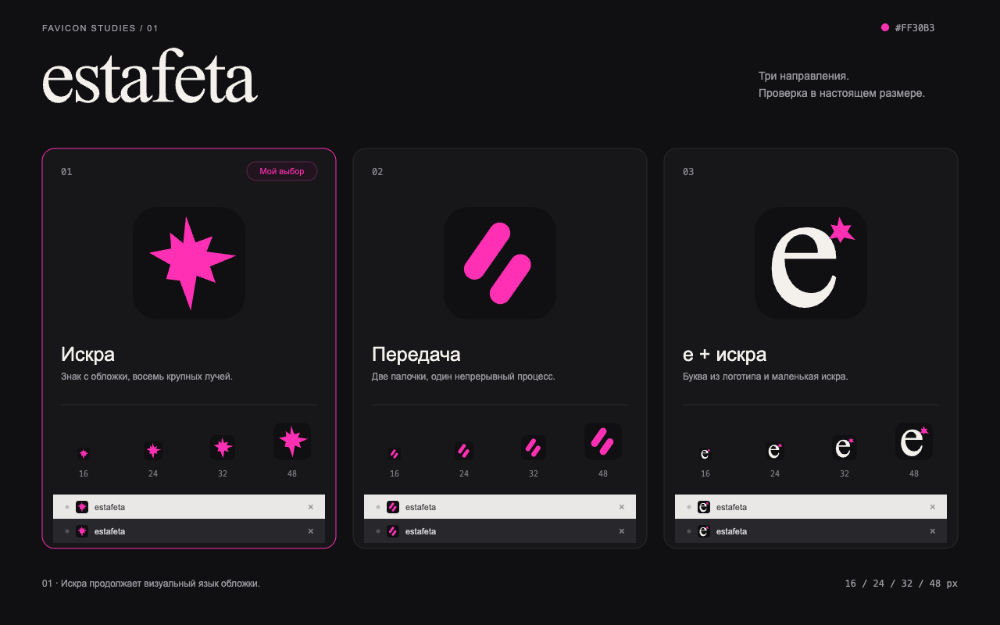

# estafeta favicon studies

Three vector directions using the brand accent `#FF30B3` on `#101012`:

1. **Spark**: an asymmetric eight-point burst inspired by the cover. Recommended.
2. **Handoff**: two staggered relay batons.
3. **e + spark**: the Nuosu SIL letterform with a pink spark.

Open `preview.html` for the interactive comparison. It is self-contained and works offline. Click a concept to change the preview tab's favicon.

`favicon.svg`, `favicon.ico`, and `favicon-*.png` contain the recommended spark concept. Each alternative has its own exports in `concepts/`.

PNG sizes: 16, 24, 32, 48, 64, 180, and 512 pixels. ICO files contain 16, 32, 48, and 64 pixel images. Rounded corners have transparency.

The monogram is outlined from Nuosu SIL. Its font license is available in [NuosuSIL-OFL.txt](../../packs/session-workflow/assets/headings/NuosuSIL-OFL.txt).
